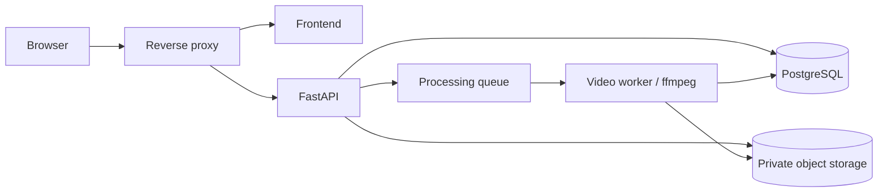
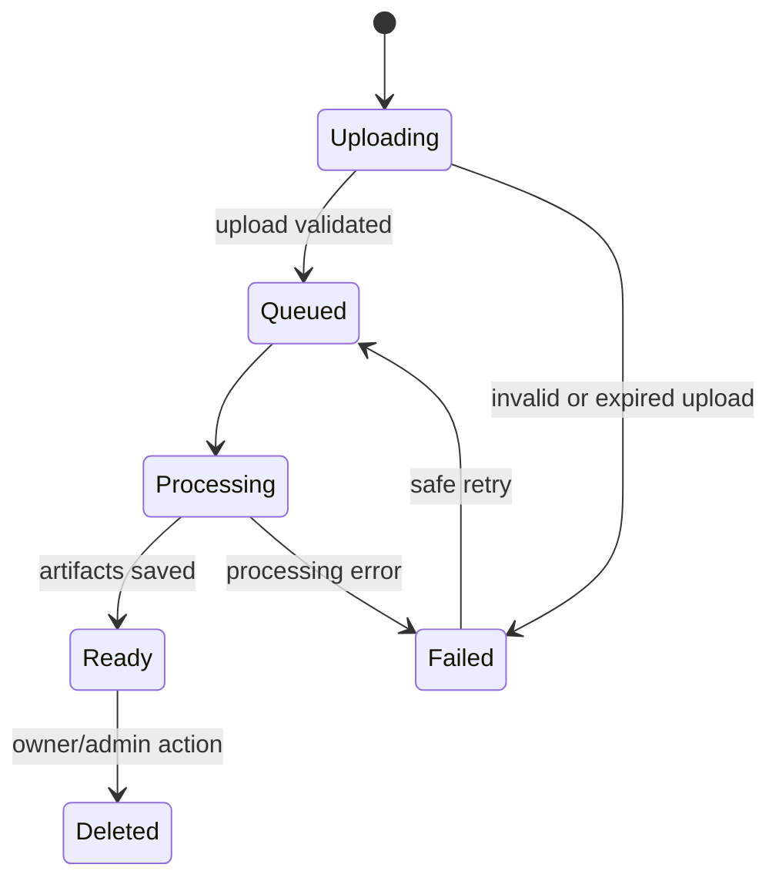

# План реализации — рекомендации, не новые требования

## Приоритет

Сначала сделайте один работающий вертикальный сценарий: регистрация → загрузка → обработка → просмотр → лайк → комментарий. Затем права доступа, модерация, похожий интерфейс и воспроизводимый деплой. Ограничения и оставшиеся функции честно перечислите в README.

## Предлагаемый стек

- Backend: Python, FastAPI, SQLAlchemy, Alembic, Pydantic. Это предложение библиотек; обязательны только FastAPI/Python и PostgreSQL.
- База: PostgreSQL, индексы для поиска и связей, транзакции для согласованных изменений.
- Файлы: S3-совместимое хранилище, например MinIO для воспроизводимой локальной установки. Видео не хранить в БД.
- Фоновые задачи: отдельный worker для ffmpeg/ffprobe, превью и конвертации; очередь можно реализовать Redis/Celery либо простой надёжной DB-очередью. Не вводите лишние сервисы без необходимости.
- Frontend: React/TypeScript/Vite либо более простой знакомый вариант; интерфейс обязан показывать реальные данные API.
- Деплой: Docker Compose, reverse proxy, отдельные тома и healthchecks; один документированный bootstrap-скрипт для чистой Ubuntu.
- Тесты: pytest для API/прав доступа; несколько end-to-end сценариев. Все версии зависимостей фиксировать lock-файлами.

## Модель данных

Рекомендуемые сущности: users, channels, videos, video_assets, upload_sessions, playlists, playlist_items, subscriptions, video_reactions, comments, video_access_grants, reports, moderation_actions, processing_jobs. Не создавайте 20 таблиц только ради числа: в самом DOCX нет такого обязательного минимума.

У video храните owner_id, title, description, visibility, processing_status, moderation_status и timestamps. Удаление/скрытие, обработка и видимость — разные состояния. Уникальные ограничения: одна реакция пользователя на видео, одна подписка на канал, отсутствие дублей в таблице разрешений. Продумайте FK, каскады и ограничения.

## Правила доступа

- Гость смотрит только разрешённые публичные видео.
- Пользователь управляет своим каналом и собственными видео.
- Private-видео доступны владельцу и явно допущенным пользователям; проверка на backend при каждом доступе к метаданным и файлу.
- Скрытое модератором видео не должно оставаться доступным по старой открытой ссылке.
- Moderator рассматривает жалобы и скрывает видео; Admin управляет ролями и административными действиями.
- Не доверяйте user_id/role из тела запроса. Проверяйте владельца ресурса на сервере.
- Для private-файлов выдавайте короткоживущие подписанные URL либо проксируйте доступ после авторизации; bucket не делать публичным целиком.

## Загрузка и воспроизведение

1. Создать upload-session с проверкой размера, квоты и типа файла.
2. Загрузить файл с отображением прогресса. Для крупных файлов желательно multipart/resume.
3. Подтвердить завершение; проверить фактический размер и формат через ffprobe.
4. Запустить idempotent job обработки, сделать превью и совместимую версию видео.
5. Отметить ready только после успешного сохранения артефактов.
6. Раздавать с Range/seek либо HLS. Учитывать приватность при раздаче.
7. Ошибки и отмены явно показывать; незавершённые uploads очищать.

## Минимальные API и UI

- Auth: регистрация, вход, выход и текущий пользователь.
- Videos: лента, детали, поиск по названию, загрузка, редактирование и видимость.
- Просмотр: плеер, лайки и комментарии, счётчик/статусы.
- Channels: профиль автора, список видео, подписки и плейлисты.
- Moderation: жалоба, список жалоб по роли, скрытие/восстановление с причиной и аудитом.
- `/docs` должен соответствовать фактическому API, включая ошибки и авторизацию.

## Этапы на доступные дни

1. Зафиксировать объём, критерии готовности и архитектуру; сделать первый коммит.
2. Поднять Compose, миграции, auth и модель доступа.
3. Завершить реальную загрузку, worker, object storage и воспроизведение.
4. Сделать ленту, поиск, страницу просмотра, канал и upload UI.
5. Добавить реакции, комментарии, подписки, плейлисты.
6. Закончить private-доступ и модерацию.
7. Автотесты критического поведения, demo seed, логи и восстановление после рестарта.
8. Проверить чистую Ubuntu и одну команду запуска.
9. Собрать ZIP с `.git`, docs и исходными AI-сессиями; воспроизвести запуск из архива.
10. Оставить резерв на исправления, не обещать рекрутеру неподтверждённый результат.

## Обязательные проверки перед сдачей

- [ ] Новый пользователь проходит весь базовый сценарий без ручного SQL.
- [ ] Второй пользователь не открывает чужое private-видео прямым API/URL.
- [ ] Обычный пользователь не вызывает moderation/admin endpoints.
- [ ] Скрытое видео не воспроизводится в обход UI.
- [ ] Ошибочный файл, превышение размера и прерванный upload обработаны.
- [ ] Перезапуск сервисов сохраняет БД и файлы.
- [ ] Фоновая задача повторяется безопасно после ошибки.
- [ ] Поиск, реакции, плейлисты и подписки согласованы с правами.
- [ ] Миграции и demo seed воспроизводимы; в демо есть пользователи, видео и комментарии.
- [ ] README содержит одну команду, версии Ubuntu/ПО, доступы к demo и известные ограничения.
- [ ] В ZIP включены `.git`, все реальные коммиты и исходные AI-экспорты по заданию.
- [ ] Секретов и данных других проектов в архиве нет.

## Диаграмма компонентов

## Состояния видео

Модерация и видимость проверяются отдельно от processing_status. Не превращайте диаграмму в замену backend-проверок.
