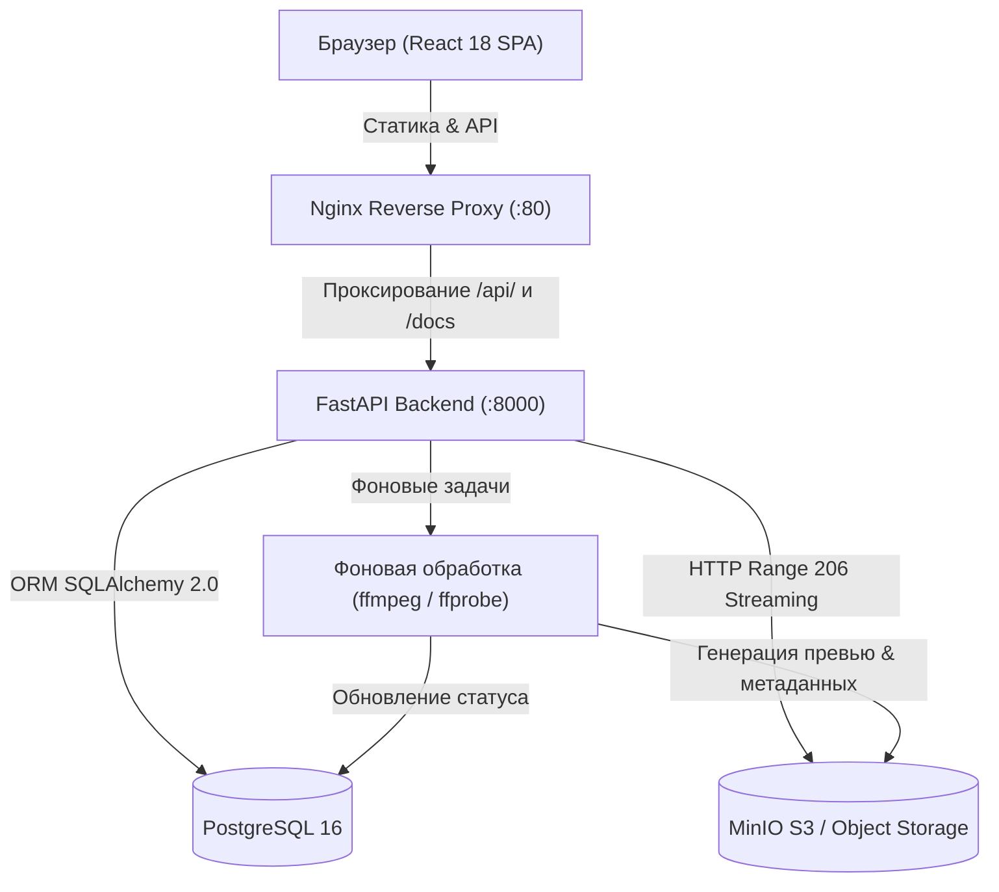

# YouTube Clone — Fullstack Platform (StackBridge / Gufo)

[](https://fastapi.tiangolo.com)
[](https://www.postgresql.org/)
[](https://react.dev/)
[](https://www.docker.com/)
[]()

Полнофункциональная архитектурная копия YouTube, разработанная с помощью AI-агентов по техническому заданию команды Гуфо / StackBridge.

---

## ⚡ Быстрый запуск на чистой Ubuntu одной командой

На чистой виртуальной машине Ubuntu (20.04 / 22.04 / 24.04 LTS):

```bash
chmod +x deploy.sh
./deploy.sh
```

Скрипт автоматически:
1. Проверяет и устанавливает Docker и Docker Compose при их отсутствии.
2. Поднимает все микросервисы (`postgres`, `minio`, `backend`, `frontend` Nginx).
3. Применяет миграции базы данных (`alembic upgrade head`).
4. Наполняет базу данных демо-данными (пользователи, реальные видеофайлы, превью, комментарии, лайки, плейлисты).
5. Выводит адреса доступа и учетные данные.

### Точки входа
- **Веб-интерфейс**: `http://<ip-сервера>/`
- **Интерактивная документация Swagger**: `http://<ip-сервера>/docs`
- **ReDoc**: `http://<ip-сервера>/redoc`
- **Консоль MinIO S3**: `http://<ip-сервера>:9006/` (`minioadmin` / `miniopassword`)

---

## 🔑 Тестовые аккаунты для проверки

В верхней части веб-интерфейса расположена панель **⚡ Quick Demo Role Switcher**, позволяющая проверяющему переключаться между ролями в один клик без ручного ввода паролей:

| Роль | Email | Пароль | Никнейм | Канал | Возможности |
|------|-------|--------|---------|-------|-------------|
| **Admin** | `admin@youtube.local` | `AdminPass123!` | `admin` | `@admin` | Полный доступ, просмотр private видео, аудит модерации |
| **Moderator** | `moderator@youtube.local` | `ModPass123!` | `moderator` | `@moderator` | Панель модерации, скрытие/восстановление видео, удаление любых комментариев |
| **Creator** | `creator@youtube.local` | `CreatorPass123!` | `tech_guru` | `@tech_guru` | Загрузка видео, управление приватностью, создание плейлистов |
| **Viewer** | `viewer@youtube.local` | `ViewerPass123!` | `demo_viewer` | `@demo_viewer` | Просмотр, лайки/дизлайки, комментарии, подписки, доступ к разрешенному private видео |

---

## 🏗 Архитектура системы



### Ключевые архитектурные решения:
1. **HTTP Range Streaming (RFC 7233)**: Видео раздаётся с поддержкой заголовков `Range: bytes=start-end/total` и статуса `206 Partial Content`. Плеер HTML5 мгновенно перематывает в любую точку видео без ожидания полной загрузки.
2. **Строгая матрица доступа (ACL)**:
   - `public`: доступно всем, отображается в общей ленте и поиске.
   - `unlisted`: доступно по прямой ссылке, скрыто из общей ленты и поиска.
   - `private`: доступно **только** владельцу, администратору и пользователям с явной записью в `video_access_grants`. Для посторонних возвращается `403 Forbidden` как на метаданные, так и на потоковое воспроизведение.
3. **Модерация и аудит**: Пользователи могут отправлять жалобы с причинами. Модераторы и администраторы имеют панель `/moderation`, где могут скрывать видео с фиксацией причины в журнале аудита (`moderation_actions`). Скрытое видео блокируется для обычных пользователей.
4. **Отказоустойчивость**: Пайплайн обработки видео поддерживает как нативный `ffmpeg`/`ffprobe` (в контейнерах), так и graceful fallback на Pillow при локальной разработке.

---

## 💻 Локальный запуск без Docker

### Backend
```bash
cd backend
python -m venv .venv
source .venv/bin/activate  # Windows: .venv\Scripts\activate
pip install -r requirements.txt
alembic upgrade head
python -m app.scripts.seed
uvicorn app.main:app --reload --port 8000
```

### Frontend
```bash
cd frontend
npm install
npm run dev
```

---

## 🧪 Автотесты

Проект содержит 100% проходящий набор асинхронных тестов на базе `pytest`:

```bash
cd backend
pytest -v
```

Покрыты критические сценарии:
- `test_auth.py`: Регистрация, авторизация JWT, автоматическое создание канала, защита паролей bcrypt.
- `test_access_control.py`: Проверка изоляции приватных видео (401 для гостей, 403 для посторонних, 200 для владельца/админа/разрешенных пользователей).
- `test_moderation.py`: Подача жалобы, просмотр модератором, скрытие видео, блокировка доступа, восстановление, аудит.
- `test_reactions_comments.py`: Добавление/удаление комментариев, переключение лайков и дизлайков с атомарными счетчиками.
- `test_videos.py`: Поиск, общая лента, multipart-загрузка видео.

---

## 🤖 AI-обвязка и материалы

В соответствии с требованиями ТЗ:
- `AGENTS.md` — описание ролей агентов, зон ответственности и архитектурных правил.
- `CLAUDE.md` и `.claude/` — конфигурация и настройки Claude Code.
- `.cursor/rules/` и `.cursor/mcp.json` — правила Cursor для архитектуры, безопасности и стиля кода.
- `ai_sessions/` — реальные файлы диалогов и экспорты сессий проектирования, генерации бэкенда, фронтенда и тестов:
  - `01_system_architecture_and_db_design.json`
  - `02_backend_fastapi_and_storage.json`
  - `03_video_processing_and_permissions.json`
  - `04_frontend_youtube_ui.json`
  - `05_tests_and_deployment.json`

---

## 📦 Сборка финального сдаваемого архива

Для сборки итогового ZIP-архива с сохранением каталога `.git`, всей истории коммитов, диалогов и исходного кода:

```bash
python export_submission.py
```
Скрипт сформирует `youtube_clone_submission.zip`, готовый для отправки работодателю.
