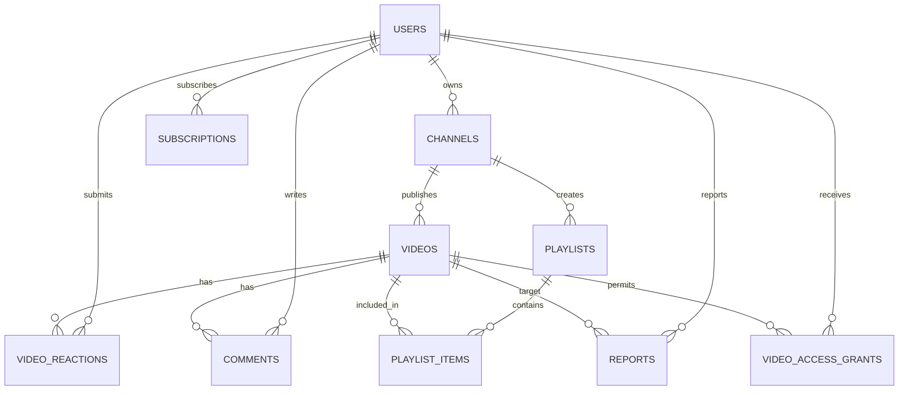

# Database Schema & Data Models

## Entity Relationship Overview

## Tables & Schema Specifications

### `users`
- `id` (UUID, Primary Key)
- `email` (VARCHAR 255, Unique, Indexed)
- `username` (VARCHAR 50, Unique, Indexed)
- `hashed_password` (VARCHAR 255)
- `full_name` (VARCHAR 100)
- `avatar_url` (VARCHAR 500, Nullable)
- `role` (ENUM: `user`, `moderator`, `admin`, Default: `user`)
- `is_active` (BOOLEAN, Default: true)
- `created_at`, `updated_at` (TIMESTAMPTZ)

### `channels`
- `id` (UUID, Primary Key)
- `user_id` (UUID, FK -> users.id, Unique, Indexed)
- `handle` (VARCHAR 50, Unique, Indexed, e.g. `@tech_guru`)
- `name` (VARCHAR 100)
- `description` (TEXT)
- `avatar_url` (VARCHAR 500, Nullable)
- `banner_url` (VARCHAR 500, Nullable)
- `subscribers_count` (INTEGER, Default: 0)
- `created_at`, `updated_at` (TIMESTAMPTZ)

### `videos`
- `id` (UUID, Primary Key)
- `channel_id` (UUID, FK -> channels.id, Indexed)
- `title` (VARCHAR 200, Indexed)
- `description` (TEXT)
- `video_url` (VARCHAR 500)
- `thumbnail_url` (VARCHAR 500)
- `duration` (FLOAT, seconds, Default: 0)
- `views_count` (BIGINT, Default: 0)
- `likes_count` (INTEGER, Default: 0)
- `dislikes_count` (INTEGER, Default: 0)
- `visibility` (ENUM: `public`, `unlisted`, `private`, Default: `public`, Indexed)
- `processing_status` (ENUM: `uploading`, `queued`, `processing`, `ready`, `failed`, Default: `uploading`)
- `moderation_status` (ENUM: `pending`, `approved`, `hidden`, Default: `approved`, Indexed)
- `created_at`, `updated_at` (TIMESTAMPTZ)

### `video_access_grants`
- `id` (UUID, Primary Key)
- `video_id` (UUID, FK -> videos.id on delete cascade, Indexed)
- `user_id` (UUID, FK -> users.id on delete cascade, Indexed)
- `created_at` (TIMESTAMPTZ)
- *Constraint: Unique (video_id, user_id)*

### `comments`
- `id` (UUID, Primary Key)
- `video_id` (UUID, FK -> videos.id on delete cascade, Indexed)
- `user_id` (UUID, FK -> users.id on delete cascade)
- `content` (TEXT)
- `created_at`, `updated_at` (TIMESTAMPTZ)

### `video_reactions`
- `id` (UUID, Primary Key)
- `video_id` (UUID, FK -> videos.id on delete cascade)
- `user_id` (UUID, FK -> users.id on delete cascade)
- `reaction_type` (ENUM: `like`, `dislike`)
- `created_at` (TIMESTAMPTZ)
- *Constraint: Unique (video_id, user_id)*

### `subscriptions`
- `id` (UUID, Primary Key)
- `user_id` (UUID, FK -> users.id on delete cascade)
- `channel_id` (UUID, FK -> channels.id on delete cascade)
- `created_at` (TIMESTAMPTZ)
- *Constraint: Unique (user_id, channel_id)*

### `playlists` & `playlist_items`
- `playlists`: `id`, `channel_id`, `title`, `description`, `visibility`, `created_at`
- `playlist_items`: `id`, `playlist_id`, `video_id`, `position`, `added_at`

### `reports` & `moderation_actions`
- `reports`: `id`, `video_id`, `reporter_id`, `reason`, `details`, `status` (`pending`, `reviewed`, `dismissed`), `created_at`
- `moderation_actions`: `id`, `moderator_id`, `video_id`, `action` (`hide`, `restore`, `delete`), `reason`, `created_at`
